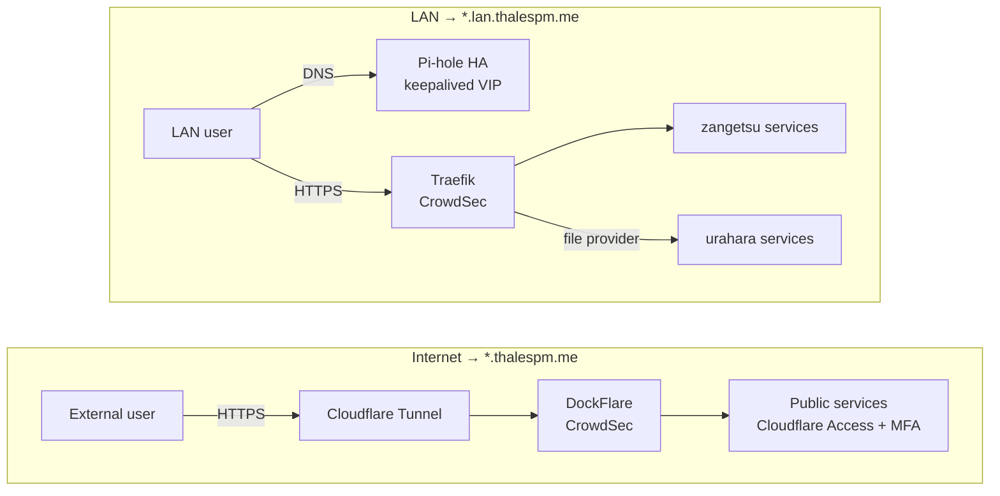
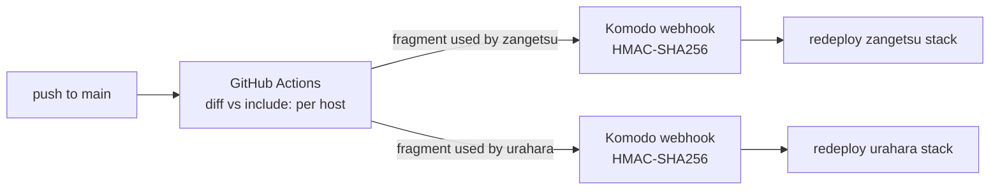

# homelab

[](https://github.com/thales-machado/homelab/actions/workflows/validate.yml)
[](https://github.com/thales-machado/homelab/actions/workflows/secrets.yml)

Infrastructure as code for a two-host self-hosted homelab: 51 Docker Compose fragments and 70+ containers, dual-path routing (LAN and internet), highly available DNS, full metrics/logs/alerting, and automated, monitored backups. Deploys are GitOps: a push to `main` redeploys only the host affected by the change.

This is the repository that actually runs my homelab: every change here is deployed to the hosts.

## Architecture



- **Private (LAN):** Traefik routes by Docker label, with a public Let's Encrypt wildcard certificate issued over DNS-01, so no port is open to the internet. Pi-hole answers split-horizon DNS and runs active/passive on both hosts behind a keepalived VIP, with config synced by Nebula Sync.
- **Public:** DockFlare turns Docker labels into Cloudflare Tunnel routes; Cloudflare Access with MFA protects anything sensitive, and only webhook paths bypass it.
- **Security:** CrowdSec blocks by IP reputation and behavior on both entry points. Tailscale subnet routers on both hosts give remote access without the public tunnel.

## Hosts

| Host | Hardware | LAN IP | Role |
|---|---|---|---|
| `zangetsu` | Raspberry Pi 5 | `192.168.15.214` | Platform core: routing, DNS, automation, observability |
| `urahara` | GMKtec K8 (Ryzen 7 8845HS) | `192.168.15.215` | Content and media: photos, documents, smart home, game streaming |

Other fixed addresses: `192.168.15.248` is the Pi-hole VIP (keepalived), `192.168.15.200` the NAS, `192.168.15.250` the UniFi controller, and `192.168.15.220` a separate machine outside this repo.

Each host has a `docker/hosts/<host>/compose.yaml` whose `include:` list is the single source of truth for what runs there. A service is a self-contained fragment in `docker/services/<category>/<service>/`; if it is not included, it is not running.

## Deploy pipeline



[`deploy.yaml`](.github/workflows/deploy.yaml) parses each host's `include:` list and only triggers the stacks whose fragments changed. A fragment used by both hosts, such as an exporter, redeploys both. Pi-hole DNS records live in [`pihole-dns.yaml`](docker/services/platform/networking/pi-hole/config/pihole-dns.yaml) and are synced by a signed webhook on change. Renovate keeps image tags current.

## Observability

- **Metrics:** VictoriaMetrics (Prometheus-compatible) scraping node-exporter, cAdvisor, blackbox-exporter, smartctl, Postgres, Redis, UniFi (unpoller), qBittorrent, Traefik, CrowdSec, rclone and Watchtower.
- **Logs:** Grafana Alloy ships container and host logs to Loki.
- **Dashboards and alerting:** 11 Grafana dashboards and alert rules provisioned from files in [`grafana/provisioning`](docker/services/observability/metrics/grafana/provisioning), so a fresh Grafana comes up fully configured.
- **Uptime and disks:** Uptime Kuma, Scrutiny for S.M.A.R.T., Dozzle with an agent per host for live container logs.

## Backup

- **Restic** snapshots `/opt` and `/etc` on both hosts to a dedicated NAS share, with GFS retention (7 daily, 4 weekly, 6 monthly).
- **Databases** get a consistent dump first (`sqlite3 .backup`, `pg_dump`) so no backup depends on copying live files.
- **Dagu** orchestrates the 10 scheduled jobs in [`dags/`](docker/services/automation/dagu/dags), and every job pings **Healthchecks**. The checks themselves are managed with Terraform in [`terraform/healthchecks`](terraform/healthchecks), with state on Cloudflare R2.
- **NAS mounts** are fixed systemd `.mount` units with `OnFailure=` notifications, and Docker waits for them with `RequiresMountsFor=`, so containers never start writing to an empty mount point.

## Services

Generated from the `include:` list of every host entry point by
`scripts/inventory/inventory.py`. CI and the pre-commit hook fail when it
is out of date, so the table cannot drift from what is deployed.

<!-- inventory:start -->

| Service | Runtime | Host | Category |
|---|---|---|---|
| `dagu` | docker | `zangetsu` | `automation` |
| `n8n` | docker | `urahara` | `automation` |
| `immich` | docker | `urahara` | `content` |
| `paperless-ngx` | docker | `urahara` | `content` |
| `stirling-pdf` | docker | `urahara` | `content` |
| `tandoor` | docker | `urahara` | `content` |
| `firefly-iii` | docker | `zangetsu` | `finance` |
| `firefly-iii-data-importer` | docker | `zangetsu` | `finance` |
| `evolution-api` | docker | `urahara` | `integration` |
| `rclone` | docker | `urahara` | `media-player` |
| `samba` | docker | `urahara` | `media-player` |
| `wolf` | docker | `urahara` | `media-player` |
| `blackbox-exporter` | docker | `zangetsu` | `observability` |
| `cadvisor` | docker | `urahara`, `zangetsu` | `observability` |
| `dozzle` | docker | `zangetsu` | `observability` |
| `dozzle-agent` | docker | `urahara` | `observability` |
| `grafana` | docker | `zangetsu` | `observability` |
| `grafana-alloy` | docker | `urahara`, `zangetsu` | `observability` |
| `loki` | docker | `zangetsu` | `observability` |
| `node-exporter` | docker | `urahara`, `zangetsu` | `observability` |
| `postgres-exporter` | docker | `zangetsu` | `observability` |
| `redis-exporter` | docker | `urahara`, `zangetsu` | `observability` |
| `scrutiny` | docker | `zangetsu` | `observability` |
| `smartctl-exporter` | docker | `urahara`, `zangetsu` | `observability` |
| `unpoller` | docker | `zangetsu` | `observability` |
| `uptime-kuma` | docker | `zangetsu` | `observability` |
| `victoriametrics` | docker | `zangetsu` | `observability` |
| `autoheal` | docker | `urahara`, `zangetsu` | `platform` |
| `cloudflared-agent` | docker | `zangetsu` | `platform` |
| `crowdsec` | docker | `urahara` | `platform` |
| `dockflare` | docker | `zangetsu` | `platform` |
| `dockflare-agent` | docker | `urahara` | `platform` |
| `healthchecks` | docker | `zangetsu` | `platform` |
| `keepalived` | docker | `urahara`, `zangetsu` | `platform` |
| `komodo` | docker | `urahara`, `zangetsu` | `platform` |
| `nebula-sync` | docker | `zangetsu` | `platform` |
| `pi-hole` | docker | `urahara`, `zangetsu` | `platform` |
| `tailscale` | docker | `urahara`, `zangetsu` | `platform` |
| `traefik` | docker | `zangetsu` | `platform` |
| `vaultwarden` | docker | `zangetsu` | `platform` |
| `watchtower` | docker | `urahara`, `zangetsu` | `platform` |
| `home-assistant` | docker | `urahara` | `smart-home` |
| `calnode` | docker | `urahara` | `utilities` |
| `homepage` | docker | `zangetsu` | `utilities` |
| `it-tools` | docker | `urahara` | `utilities` |
| `openspeedtest` | docker | `zangetsu` | `utilities` |
| `qbittorrent` | docker | `urahara` | `utilities` |
| `thalesmachado-net` | docker | `zangetsu` | `utilities` |
| `trilium` | docker | `urahara` | `utilities` |
| `vikunja` | docker | `urahara` | `utilities` |

<!-- inventory:end -->

## Conventions

- Resource limits on every container (`cpus`, `mem_limit`, `pids_limit`).
- Bind mounts under `/opt/apps/<service>/`, never named volumes, so Restic sees everything.
- Secrets only through `env_file: .env`, named `<SERVICE>_<PURPOSE>`; see each host's [`.env.example`](docker/hosts/zangetsu/.env.example).
- Networks declared only in the host `compose.yaml`; fragments only reference them.
- Services reach the Docker API through a socket proxy by default; the few that mount the socket directly are listed, with reasons, in `CONVENTIONS.md`.

The full set of rules, and the incidents behind them, is in [`CONVENTIONS.md`](CONVENTIONS.md).

## Layout

```text
docker/hosts/<host>/compose.yaml    entry point per host: include: list + host overrides
docker/services/<category>/<service>/  one self-contained Compose fragment per service
scripts/                     setup, backup, networking and systemd units
terraform/healthchecks/      Healthchecks.io checks as code
.github/workflows/           validation and secret scanning, path-aware deploy, DNS sync
docs/                        runbooks (backup, Komodo, Traefik/DockFlare, Wolf)
```

## Checks

Every push runs two workflows:

- **validate**: yamllint, `docker compose config` on each host entry point against its `.env.example`, shellcheck, `python -m py_compile` and `terraform fmt -check`.
- **secrets**: gitleaks over the full history, plus a weekly scheduled run.

The same checks run locally through `pre-commit`:

```bash
pip install pre-commit && pre-commit install
pre-commit run --all-files
```

## License

All rights reserved. See [`LICENSE`](LICENSE).
